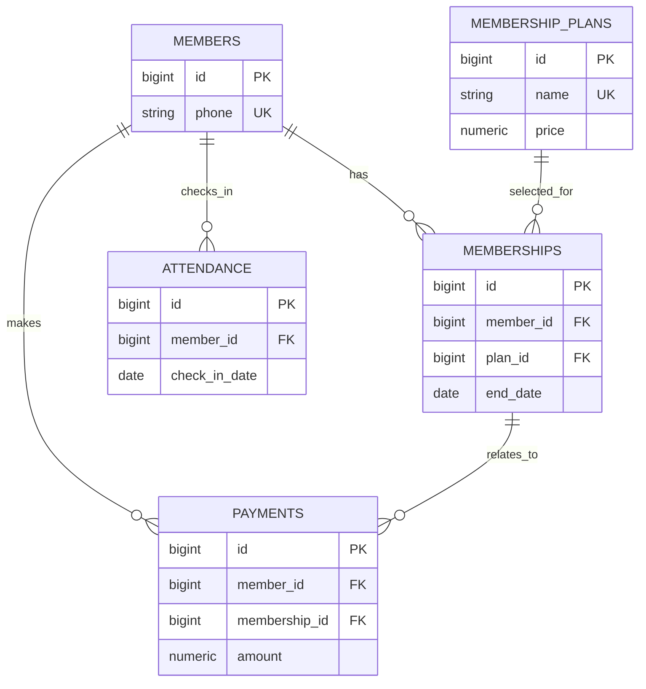

# FitTrack — Gym Management System

FitTrack is a database-backed college DBMS project for managing gym members, plans, memberships, check-ins and recorded payments.

## Run locally with PostgreSQL

Requirements: Node.js, pnpm, and Docker Desktop.

The project includes a PostgreSQL 16 Docker service for a complete local demo. On first setup, create your local environment file from the template:

```powershell
Copy-Item .env.example .env
pnpm install
docker compose up -d --wait
pnpm db:init
pnpm db:seed
pnpm dev
```

Open `http://localhost:5173`. The local database remains available after a restart because Docker stores it in the `fittrack_postgres_data` volume.

## Optional: Supabase setup

To use Supabase instead, create a project at [Supabase](https://supabase.com/dashboard), then copy the **Session pooler** PostgreSQL URI from **Project Settings → Database → Connect**. Put it in `DATABASE_URL` in your local `.env` file. Never commit `.env`.

```powershell
pnpm install
pnpm db:init
pnpm db:seed
pnpm dev
```

Open `http://localhost:5173`. The frontend runs on Vite and proxies `/api` calls to the Express server on port 3000.

To simulate a production build locally:

```powershell
pnpm build
pnpm start
```

Open `http://localhost:3000`.

## What works

- Member creation, listing and protected deletion
- Membership-plan creation and plan assignment
- PostgreSQL-persisted attendance; duplicate member/date check-ins receive a `409 Conflict`
- Payment recording; PostgreSQL prevents a payment from being linked to another member’s membership
- Live dashboard counts and revenue totals from SQL
- Validated REST API with meaningful database-error responses

## Database design

| Table | Purpose | Important integrity rules |
|---|---|---|
| `members` | Member profile | primary key; unique phone/email; status check |
| `membership_plans` | Prices/durations | unique name; positive price and duration |
| `memberships` | Member-plan history | FKs; valid date range; protected history |
| `attendance` | Daily check-ins | FK; unique `(member_id, check_in_date)` |
| `payments` | Recorded payments | positive amount; FKs; composite FK validates payment owner |



## DBMS explanation

Each attribute is atomic (1NF). Non-key fields in every table depend on that table’s key (2NF). Member details, plan prices and payment data live separately, so non-key fields do not depend on other non-key fields (3NF). Foreign keys prevent orphan history; unique keys prevent repeated phone numbers, plans and daily check-ins. Date indexes support expiry reports and attendance-date filtering.

## SQL reports

Run the commented queries in [database/reports.sql](database/reports.sql) from the Supabase SQL Editor after schema initialization. They demonstrate `JOIN`, `LEFT JOIN`, `WHERE`, `ORDER BY`, `GROUP BY`, `HAVING`, `COUNT`, and `SUM`.

## API overview

`GET/POST /api/members`, `PUT/DELETE /api/members/:id`, `GET/POST /api/plans`, `GET/POST /api/memberships`, `GET/POST /api/attendance`, `GET/POST /api/payments`, `GET /api/dashboard`, and `GET /api/health`.

## Testing checklist

After setting up the database, verify these in the interface: create/edit a member, attempt a duplicate phone, assign a membership, record check-in twice on the same day, record a payment, refresh, and compare dashboard figures with `reports.sql`. The database rules—not only the UI—reject invalid relationships and duplicate attendance.

## Viva quick answers

- **Why PostgreSQL?** It is a real relational database with strong constraints, transactions and SQL reporting.
- **Primary key vs foreign key?** A primary key uniquely identifies a row; a foreign key requires an existing related row.
- **How are duplicate check-ins prevented?** The `UNIQUE(member_id, check_in_date)` constraint rejects them even if an API/UI is bypassed.
- **How is a wrong payment relationship prevented?** A composite foreign key requires `(membership_id, member_id)` to match the same row in `memberships`.
- **Why an API?** The React browser calls Express, which validates input and sends parameterized PostgreSQL queries. Database credentials never reach the browser.
- **WHERE vs HAVING?** `WHERE` filters rows before grouping; `HAVING` filters grouped aggregate results.

## Project status

The checked-in `.env.example` is configured for the local Docker database. `.env` is ignored by Git; use it for local database credentials or your private Supabase URI.
